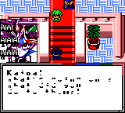
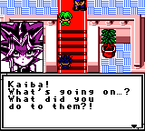

# Yu-Gi-Oh! MCGB — Universal Graphics Fix

## Overview

After an immense amount of digging through assembly code, the fix is in!

This patch fixes two graphics-related issues in the official translation of the Game Boy Color version of **Yu-Gi-Oh MCGB**:
1. An early startup LCD initialization issue that could interfere with the initial text display.
2. A VRAM synchronization issue that could cause corrupted graphics during gameplay.

The fixes were developed by comparing the English and Japanese versions of the game, identifying differences in their graphics-transfer routines, and adapting the safer Japanese implementation for the English code layout.
The patch preserves the original game content, translations, and gameplay while correcting the affected initialization and graphics routines.

## What Was Wrong?

### 1. VRAM Access Without Synchronization

The primary graphics issue was traced to the routine responsible for transferring data between system memory and video RAM (VRAM).
The non-Japanese language versions of the ROM included in EDC performed these transfers without checking the Game Boy Color's LCD status register before accessing VRAM.
The problem is that VRAM is not available to the CPU during certain LCD operating modes. In particular, CPU access is restricted during PPU modes 2 and 3.
When the game attempted to read VRAM during one of these modes, it could receive invalid data instead of the expected graphics data. In our investigation, these invalid reads could return `$FF`, which was subsequently copied into memory.
This explains why graphics could become corrupted even though the underlying graphics data was present in the ROM.

### How the VRAM Fix Works

The Japanese version of the game contains a more careful implementation of the same graphics-transfer routine.
Instead of accessing VRAM immediately, it checks the LCD status register (`$FF41`) and tests bit 1:

```asm
ldh a, [$FF41]
bit 1, a
jr nz, wait
```

If bit 1 is set, the CPU waits until the PPU leaves the restricted modes before accessing VRAM.
This synchronization check is performed around the relevant memory operations, preventing the game from reading or writing VRAM when it is unavailable.
The Japanese routine was adapted into the corresponding routine in the English and other language versions.
The replacement occupies the original routine's space at ROM offset `0x27EC`. Any remaining unused space in that region is filled with NOP instructions (`$00`).
This preserves the surrounding code layout and avoids moving other game routines.

### 2. Early Startup LCD Initialization

The original startup routine called the initialization code at `$0A11` without first ensuring that the LCD was enabled.
This could interfere with the early text initialization and display.
An earlier fix addressed this by redirecting the original call through a small helper routine.

### 3. Corrections to VRAM Sync

In the version of the ROM shipped with EDC, there are issues with VRAM synchronization that cause corruption or missing glyphs to appear on the stats screen.
This was resolved by using some free space to modify the game's numeric tile-writing routine ($0C8C) with more reliability.
Previously, tile IDs were written to VRAM without checking that the PPU allowed VRAM access; because these writes would take place during PPU mode 3, things broke.

## Patch Details

Before: <br>
  

After: <br>
  


| Item | Value |
|---|---|
| Game | Yu-Gi-Oh MCGB |
| Platform | Game Boy Color |
| ROM size | 2 MiB |
| Startup hook | `0x0186` |
| LCD helper routine | `0x3F61` |
| VRAM routine | `0x27EC–0x2876` |
| VRAM synchronization | LCD STAT bit 1 |
| Output format | Game Boy Color ROM |
| Patch format | IPS |

### Original English ROM Identification

The original English ROM (extracted from Early Days Collection using [Cowabunga](https://github.com/Masquerade64/Cowabunga)) has the following MD5 hash:

```text
308ed22c743901070fa520f982f0c95b
```

Your IPS patcher should identify compatible ROMs using the expected code signatures and layout, rather than relying exclusively on the English ROM's MD5 hash.

## Language Compatibility

The following language versions were examined for compatibility with the patch:

| Language | Compatibility |
|---|---|
| English (gbc_ygo_mcgb_en.gbc) | Compatible |
| Japanese (gbc_ygo_mcgb_jp.gbc) | Incompatible, fix not needed |
| Spanish (gbc_ygo_mcgb_es.gbc) | Compatible |
| French (gbc_ygo_mcgb_fr.gbc) | Compatible |
| Italian (gbc_ygo_mcgb_it.gbc) | Compatible |
| German (gbc_ygo_mcgb_de.gbc) | Compatible |

The localized versions retain their own language-specific text and game content. The patch modifies the relevant executable routines rather than replacing the game with another language version.
Structural compatibility checks confirm that the expected startup hook, helper space, and VRAM routine are present at the required locations.
Runtime testing on additional language versions is recommended before considering every localization fully validated.

## Applying the Patch

1. Make a backup of your original ROM.
2. Use an IPS patching utility in conjunction with the provided IPS patch and a compatible, unmodified ROM.
3. Allow the patcher to verify the ROM before making changes.
4. Open the patched ROM in a Game Boy Color emulator or on supported hardware.
5. Verify that startup text displays correctly and that graphics remain intact during gameplay.

The patcher should reject unsupported or modified ROMs rather than attempting to patch them blindly.

## Technical Notes

The VRAM synchronization fix is based on the safer graphics-transfer implementation found in the Japanese version of Yu-Gi-Oh MCGB.
The LCD initialization fix was developed by examining the game's startup sequence and adding a small helper routine without disturbing the original initialization flow.

And with this fix, this officially translated ROM is no longer confined to inaccurate emulators or being played inside the EDC frontend!

## AI Disclosure

This fix was developed with assistance from ChatGPT as assembly code is difficult for humans to parse in a timely manner.
